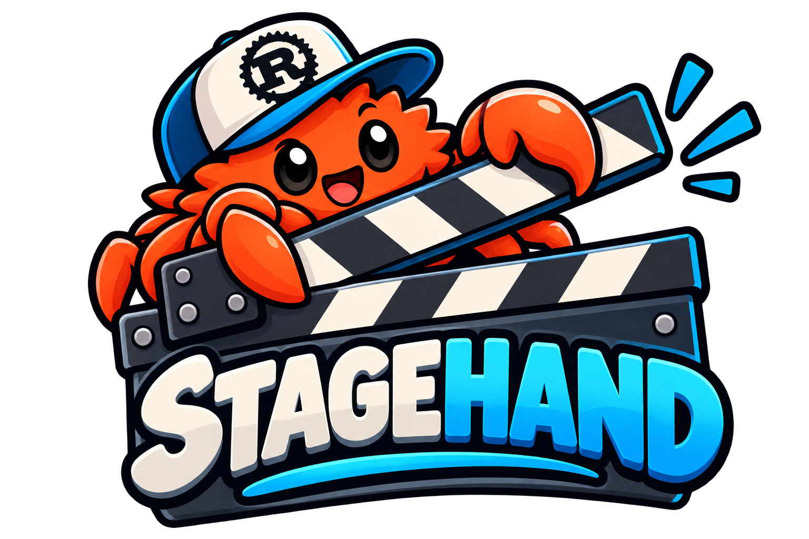

# stagehand

<div align="center">



**Repeatable conference demos in disposable micro-VMs.**

[](https://smolmachines.com)


</div>

> 🎬 *The stagehand builds the set, lays the props, and strikes it all after the show — so the same demo runs flawlessly, every single time.*

Run repeatable conference demos in disposable [smolvm](https://smolmachines.com) micro-VMs.

One command starts a **fresh Linux VM with your tools already installed** (an AI
harness, language toolchains — whatever `demo.toml` declares), your API keys and
SSH agent forwarded in, and the demo's webapp port reachable at a URL that never
changes. When you exit, the machine stops itself — the session stays preserved
on the VM's disk, ready to resume, and nothing keeps running on your Mac.

```
stagehand build            # once: template VM → golden image with your tools
stagehand new              # fresh VM, fixed port, drops you inside —
                           # exiting stops the machine (session preserved)
stagehand resume           # back into the newest session — exiting stops again
stagehand resume 2         # or a specific preserved session (see list)
stagehand new --no-attach  # start it without dropping in
stagehand stop             # halt a --no-attach machine
stagehand strike           # after the conference: delete every demo VM
```

The file IS the demo — no `[demos.*]` sections, no names to type. Every run
gets a numbered **session** (`your-demo-1`, `-2`, …); `stagehand new` archives
any still-running session first, so the fixed port is always free. Need a
second demo? Give it its own config file in the same folder and select it
with `--config` (they share the golden image).

## Why this shape

- **A fresh VM per demo run.** `stagehand new` clones a golden image
  (~sub-second boot), so every showing of the demo starts from a known-good
  state. Old machines are kept, not deleted — run the same demo five times
  and you get sessions `1..5`, each preserved.
- **Fixed ports, declared once.** Each demo gets a permanent host port in
  `demo.toml`. Forwarding is attached to the VM at creation, so
  `http://localhost:8410` works the moment the guest listens — and it is the
  same place every single time.
- **Sessions survive the machine stopping.** Tools store their session
  history and workspace on the VM's persistent overlay. Stopping the VM uses
  no CPU/RAM; `stagehand resume` boots it again, drops you back inside, and
  stops it again when you exit.
- **Secrets stay on the host.** API keys are bound **host-side** with smolvm's
  credential feature: the VM only ever sees a meaningless `SMOLPLACEHOLDER_*`
  value in the env var, and smolvm substitutes the real value from your shell
  environment on HTTPS requests to the provider's hosts. The secret itself
  never enters the VM — not on disk, not in the image, not even in process
  memory of the guest.
- **Demo folders are copies, not mounts.** `include = ["/path/to/repo"]`
  brings a folder into the VM as a fresh copy every run — mess with it,
  commit in it, delete it; the host original never changes.

## Setup

In any directory (it becomes your demo workspace):

```sh
stagehand init                  # writes a starter demo.toml
$EDITOR demo.toml               # set your port, tools, entrypoint, includes
stagehand build                 # ~5 min once: installs packages + tools in a
                                #   template VM, then packs and extracts it to
                                #   .stagehand/rootfs (what demo machines clone)
```

`demo.toml` reference:

```toml
# name = "my-demo"              # machine/session naming stem (default: this directory's name)
port = 8410                     # FIXED host port — the demo's permanent URL
# include = ["/path/to/repo"]   # folders COPIED into /workspace at `stagehand
#                               # new` time — fresh copy every run, the host
#                               # original is never mounted or modified

[build]                         # the golden image recipe — assembled by `stagehand build`
image = "debian:bookworm-slim"  # base image
packages = ["git", "curl"]      # distro packages installed into the image
tools = ["node@lts", "some-cli@latest"]  # mise tools installed into the image
entrypoint = "some-cli"         # what `stagehand new` lands in (default: shell)
shell = "/bin/bash"             # shell used when no entrypoint is set
workspace = "/workspace"        # working directory for new/resume/exec
setup = """                     # extra provisioning script, runs in the template
your-setup-command --here
"""

[builder]                       # optional — cross-compile stage for Linux artifacts
image = "debian:bookworm-slim"  # builder base image
source = "/path/to/your/repo"   # host dir mounted at /src inside the builder
tools = ["rust@stable"]         # mise tools installed in the builder first
artifacts = ["my-tool"]         # files under /build/artifacts/ to install into the image
script = """                    # runs in the builder VM (persistent, incremental)
cargo build --release --manifest-path /src/Cargo.toml -p my-cli
cp /build/target/release/my-tool /build/artifacts/my-tool
"""

[defaults]
guest_port = 8080               # where your webapp listens inside the VM
net = true                      # outbound networking from the VM
ssh_agent = true                # forward the host SSH agent (git push/pull from the VM)

# Host-side credential bindings (recommended): the VM sees a placeholder,
# the real value is substituted on HTTPS requests to the hosts you list —
# and nowhere else. List every host the credential is actually sent to
# (the host must match what the client really connects to), and have the
# env var set in your shell whenever a machine is STARTED.
[defaults.credentials.MY_API_KEY]
hosts = ["api.example.com"]

# Plain secrets: the value IS visible inside the VM (for non-HTTPS tools).
# secret_env = ["SOME_PLAIN_TOKEN"]
```

Two-stage model, like a multi-stage Dockerfile: `[builder]` (optional)
produces Linux artifacts, `[build]` assembles the golden image from a base
image + packages + mise tools + `setup`, and copies `[builder]` artifacts
into it at `/usr/local/bin/`. Demo VMs are clones of that image.

Tooling is managed by [mise](https://mise.jdx.dev): `tools` specs are installed
with `mise use -g` in the respective VM, and every template tool is symlinked
to `/usr/local/bin/` so non-mise shells (and `stagehand exec`) see it.
**All of this happens inside the VMs — the host never needs mise; it only
needs [smolvm](https://smolmachines.com).**

Artifacts built by `[builder]` land at `/usr/local/bin/<name>` in the golden
image — `stagehand build` runs `<artifact> --version` inside the template to
verify each one. The builder machine persists (`stagehand-builder-<dir>`), so
toolchains and `target/` survive across builds; only the first build is slow
(a cold Rust build took ~5 min; rebuilds are seconds).
`stagehand build --force` recreates both template and builder.

## Commands

| Command | What it does |
|---|---|
| `stagehand init` | Write a starter `demo.toml` |
| `stagehand build [--force]` | (Re)build the golden image from the `[build]` recipe + `[builder]` stage |
| `stagehand new [--no-attach] [-- cmd]` | Fresh VM, started, lands in the entrypoint; exiting stops the machine |
| `stagehand resume [SESSION] [-- cmd]` | Resume a specific (or the newest) session, land inside; exiting stops it again |
| `stagehand exec [--detach] [-- cmd]` | Run a one-off command in the newest machine (`--detach` for background servers) |
| `stagehand url` | Print the demo's permanent URL |
| `stagehand stop` | Halt the running session (or the newest), session preserved |
| `stagehand list` | Sessions, demo, state, port, machine |
| `stagehand reset` | Throw away the newest machine, start a fresh one (same port) |
| `stagehand rm [--all]` | Delete machines of this demo |
| `stagehand strike` (alias `cleanup`) `[--template]` | Delete **all** demo machines (conference is over) |

## Conference-day runbook

The night before:

```sh
stagehand build                 # refresh the golden image if [build] changed
stagehand new --no-attach && stagehand stop   # dress rehearsal, archived
```

On stage, per showing:

```sh
stagehand new                   # fresh VM, drop straight in
# ... run the demo; the webapp is at http://localhost:8410 ...
#   start a webserver from another terminal, e.g.:
#   stagehand exec --detach -- python3 -m http.server 8080 --directory /workspace
exit                            # machine stops itself, session archived
```

Questions from the audience about yesterday's run?

```sh
stagehand resume                # boots the archived machine, drops you inside
```

Flying home:

```sh
stagehand list                  # see everything
stagehand strike                # delete all demo VMs (golden image is kept)
```

## Notes

- Machine names (`<demo>-3`) and their project are tracked via smolvm labels,
  so `list`/`rm`/`strike` only ever touch stagehand's own machines. The stem
  comes from the optional `name` key, defaulting to `demo.toml`'s directory
  name.
- The golden image lives under `.stagehand/` next to your `demo.toml`
  (gitignored): `rootfs/` is what demo machines clone, `golden.smolmachine`
  is the portable pack it was extracted from. Deleting both is safe —
  `stagehand build` recreates them.
- The template machine `stagehand-template-<dir>` is reused across builds;
  pass `--force` to rebuild it from scratch.
- Every `tools` binary is on PATH in the image; sessions start in
  `/workspace` (created empty in the golden image). Git works out of the box
  through the forwarded SSH agent.
- Credential bindings resolve the real value from the environment of whatever
  shell **starts** the machine (`stagehand new` / `resume`). If it's missing,
  requests to the bound hosts fail closed with
  `smolvm credentials: credential unavailable` — set the var and restart the
  machine. stagehand warns at start when it can tell a var is missing.
- Demo machines are created with `machine create --image <rootfs>` rather
  than `--from <pack>` because smolvm 1.18.0 silently drops
  `--credential`/`--secret-env` flags on the pack path.

## Install

Grab a prebuilt binary from [Releases](https://github.com/geekgonecrazy/stagehand/releases)
(macOS arm, Linux x64/arm64 — static on Linux), or build from source:

```sh
cargo install --path .          # installs `stagehand` onto your PATH
```

Requires [smolvm](https://smolmachines.com) on PATH (or `SMOLVM_BIN=/path/to/smolvm`).
Toolchains (mise, rust, go, …) live inside the VMs — the host never needs them.

## License

MIT — see [LICENSE](LICENSE).
